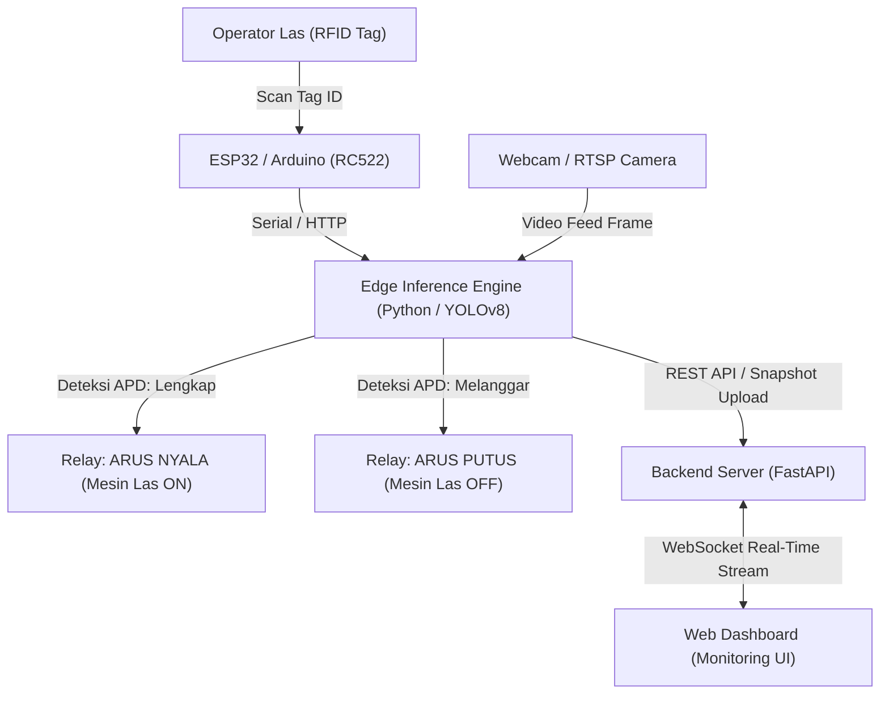

# ⚡ WeldGuard — Industrial IoT & AI Welding Safety Interlock System

[](https://fastapi.tiangolo.com/)
[](https://python.org)
[](https://ultralytics.com)
[](https://espressif.com)
[](https://developer.mozilla.org/en-US/docs/Web/API/WebSockets_API)
[](https://youtu.be/vaSmvxb3h44)

> **WeldGuard** adalah sistem proteksi keselamatan kerja industri berbasis **Edge Computing**, **Computer Vision (YOLOv8)**, dan **Internet of Things (IoT)** yang dirancang untuk mencegah kecelakaan fatal pada operator pengelasan (*welding*). Sistem secara otomatis mengunci arus listrik mesin las (*hardware relay interlock*) apabila operator tidak menggunakan Alat Pelindung Diri (APD) helm las dan sarung tangan pelindung secara patuh.

---

## 🎥 Video Demonstrasi & Poster Proyek
* 📺 **Video Demo Sistem Berjalan (YouTube):** [https://youtu.be/vaSmvxb3h44](https://youtu.be/vaSmvxb3h44)
* 📄 **Poster Teknis Proyek:** Dokumen poster tersedia di folder [`docs/Kelompok 5_Poster_IoT.pdf`](./docs/Kelompok%205_Poster_IoT.pdf)

---

## 📌 Fitur Unggulan Sistem (Key Features)

1. **Deteksi APD Real-Time Berbasis AI:**
   Model kustom **YOLOv8** mendeteksi keberadaan operator las, helm las (*welding helmet*), dan sarung tangan pelindung (*gloves*) menggunakan kamera edge dengan latensi rendah.
2. **Hardware Interlock Otomatis (Relay Trip):**
   Jika operator melepaskan APD saat mesin aktif, sistem inferensi edge langsung mengirim perintah ke microcontroller (ESP32/Arduino) untuk memutus relay mesin las dalam waktu < 500 ms (*fail-safe protection*).
3. **Autentikasi Operator Berbasis RFID:**
   Integrasi reader **RC522 RFID** untuk validasi identitas dan lisensi sertifikasi juru las sebelum stasiun kerja dapat diaktifkan.
4. **Live Monitoring Web Dashboard (WebSocket):**
   Pemantauan telemetri stasiun las, status relay mesin (ON/OFF), dan status kepatuhan APD secara instan tanpa perlu me-refresh halaman web browser.
5. **Incident Logging & Auto Snapshot Capture:**
   Setiap pelanggaran APD secara otomatis tersimpan ke basis data insiden lengkap dengan bukti foto snapshot rekaman kamera saat pelanggaran terjadi.

---

## 🏗️ Arsitektur Sistem (System Architecture)



---

## 📂 Struktur Direktori Proyek

```text
Weldguard/
├── backend/                  # FastAPI Application Server & API Endpoints
│   ├── main.py               # REST Endpoints, WebSocket Manager & Static Mount
│   ├── data.json             # In-Memory & File Persistence Database
│   ├── requirements.txt      # Backend Python Dependencies
│   └── snapshots/            # Penyimpanan Foto Pelanggaran Insiden
├── inference_engine/         # Core AI Inference & Hardware Decision Logic
│   ├── inference.py          # YOLOv8 Camera Loop & Proximity Detection
│   ├── inference_rfid.py     # Integrasi Serial RFID Scanner + Kamera
│   ├── config.py             # Konfigurasi Threshold, IP ESP32 & Endpoint
│   ├── best.pt               # Bobot Model YOLOv8 Terlatih (Trained Weights)
│   └── requirements.txt      # Inference Dependencies (Ultralytics, OpenCV, PySerial)
├── iot-dashboard/            # Frontend Web Monitoring Dashboard
│   ├── index.html            # Beranda Ringkasan Statistik Stasiun
│   ├── live-monitoring.html  # Live View Status Mesin & Status APD
│   ├── incident-log.html     # Log Riwayat Pelanggaran & Bukti Foto
│   ├── worker-management.html# Manajemen Data Operator & ID RFID
│   ├── css/ & js/            # UI Styling & WebSocket Handler
│   └── assets/               # Aset Ikon & Gambar UI
├── esp32/                    # Firmware Microcontroller C++ / Arduino
│   ├── weldguard_relay.ino   # HTTP WebServer Kontrol Relay Mesin Las
│   └── weldguard_rfid_serial/# Pembacaan Tag RFID RC522 via Serial UART
└── docs/                     # Diagram Blok, Flowchart Sistem & Poster
```

---

## 🔌 Rangkaian Perangkat Keras (Hardware Wiring)

| Perangkat | Pin Komponen | Pin Microcontroller (ESP32) | Keterangan |
|---|---|---|---|
| **Modul Relay 5V** | `IN` | `GPIO 26` | Kontrol ON/OFF saklar daya mesin las |
| | `VCC` | `5V (VIN)` | Catu daya relay |
| | `GND` | `GND` | Ground bersama |
| **RFID-RC522** | `SDA (SS)` | `GPIO 5` | SPI Chip Select |
| | `SCK` | `GPIO 18` | SPI Clock |
| | `MOSI` | `GPIO 23` | SPI MOSI |
| | `MISO` | `GPIO 19` | SPI MISO |
| | `RST` | `GPIO 22` | Reset Pin |
| | `3.3V` | `3.3V` | Catu daya modul RFID (Perhatian: 3.3V!) |

---

## 🚀 Panduan Menjalankan Sistem (Getting Started)

### 1. Menjalankan Backend Server (FastAPI)
Buka terminal pertama:
```bash
cd backend
pip install -r requirements.txt
python main.py
# Backend API berjalan di: http://localhost:8000
# Dokumentasi Swagger UI: http://localhost:8000/docs
```

### 2. Membuka Web Dashboard Monitoring
Cukup buka file `iot-dashboard/index.html` langsung di browser web favorit Anda (atau gunakan ekstensi *VS Code Live Server*). Dashboard akan otomatis terhubung ke WebSocket `ws://localhost:8000/ws`.

### 3. Flash Microcontroller (ESP32 / Arduino)
1. Buka file `esp32/weldguard_relay.ino` di **Arduino IDE**.
2. Sesuaikan konfigurasi SSID dan Password WiFi lokal Anda.
3. Upload kode ke board ESP32, catat alamat IP yang muncul pada Serial Monitor, lalu masukkan IP tersebut ke dalam `inference_engine/config.py`.

### 4. Menjalankan AI Inference Engine
Buka terminal kedua:
```bash
cd inference_engine
pip install -r requirements.txt
python inference.py
```
*(Untuk pengujian dengan pemindai RFID fisik via Serial port, jalankan `python inference_rfid.py`)*.

---

## 👥 Tim Pengembang (Kelompok 5 — UGM)

Proyek ini dikembangkan sebagai Proyek Akhir Praktikum IoT pada Program Studi **D-IV Teknologi Rekayasa Internet**, Departemen Teknik Elektro dan Informatika, Sekolah Vokasi, **Universitas Gadjah Mada (UGM)**:

* **Fadli Sutaji Muidita** (24/540298/SV/24814) — *Back-End Engineer, IoT Architecture & Cloud Integration*
* **Bintang Ahimsa Pradana** (24/539363/SV/24590)
* **Naufal Khairdzaky Hascaryo** (24/539630/SV/24639)
* **Ilham Mubarok Al Rantisi** (24/543892/SV/252285)

---

## 📜 Lisensi
Didistribusikan di bawah lisensi **MIT License**. Lihat berkas [LICENSE](./LICENSE) untuk informasi lebih lanjut.